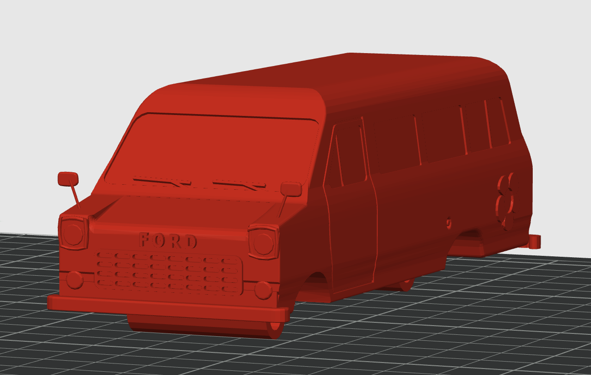
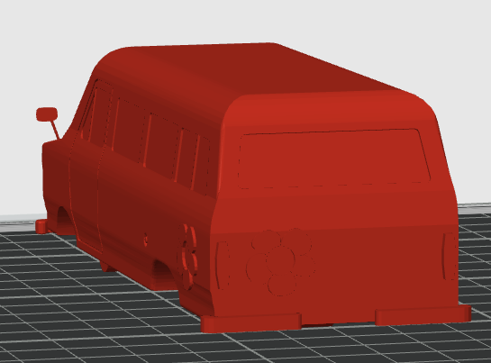
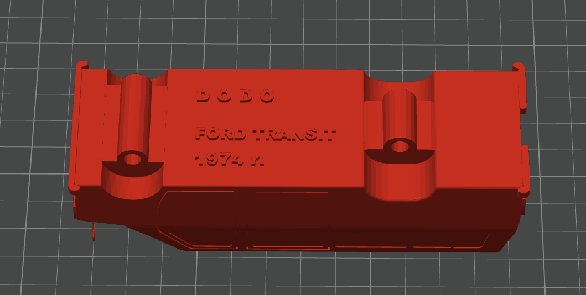
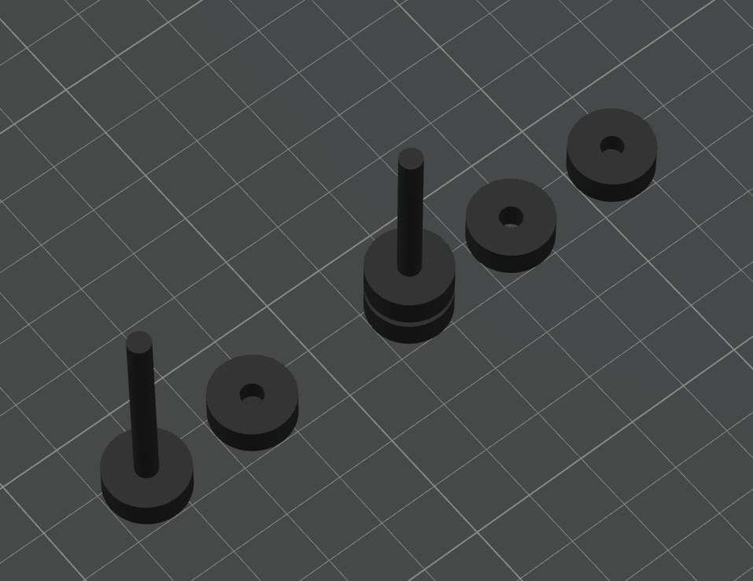

# Ford Transit Mk1 (1974) – Autodesk Inventor & 3D Printing

CAD project for the Ford Transit Mk1 in Autodesk Inventor, including 3D parts (`.ipt`), assembly (`.iam`), 2D technical drawings (`.idw`, `.pdf`), and 3D-printable mesh/project files (`.stl`, `.3mf`) prepared for printing.

## Preview
**Car body - front:**

**Car body - back:**

**Car body - bottom:**

**Wheels and axles:**

**2D main dimensions**:

Full PDF drawing: [final-scale-1-25/transit-main-dimensions.pdf](final-scale-1-25/transit-main-dimensions.pdf)

## Project Structure
- `final-scale-1-25/` – final print-ready version scaled by `1.25`:
  - `transit.3mf` – multi-color / print project setup with a **red** body (`body`) and **black** remaining parts (wheels with axles)
  - `transit-whole.iam` – full assembly
  - `transit-main-dimensions.idw` & `transit-main-dimensions.pdf` – 2D drawing and main dimensions
  - `body.ipt`, `body.stl`, `wheel.ipt`, `wheel.stl`, `wheel_for_twin.ipt`, `wheel_for_twin.stl`, `wheel_on_axle.ipt`, `wheel_on_axle.stl`, `wheel_on_axle_twin.ipt`, `wheel_on_axle_twin.stl` – scaled 3D parts and STL meshes
- `random/` – earlier scaled draft version
- Root folder – original-size parts (including `transit-original-size-boxy.ipt` prior to fillets)

## Parts & Quantities
- `wheel` – 2 pcs
- `body` / `transit-original-size-boxy` – 1 pc
- `wheel_for_twin` / `wheel-for-twin` – 1 pc
- `wheel_on_axle` / `wheel-on-axle` – 1 pc
- `wheel_on_axle_twin` / `wheel-on-axle-twin` – 1 pc

## Mass / Print Estimate
Estimated filament usage in Bambu Studio (scale `1.25`):

| Filament / Part | Model | Support | Total |
| :--- | :--- | :--- | :--- |
| **Red (Filament 1 – body)** | 54.11 g (17.85 m) | 6.52 g (2.15 m) | **60.63 g** (20.01 m) |
| **Black (Filament 4 – wheels & axles)** | 4.60 g (1.52 m) | 0.00 g (0.00 m) | **4.60 g** (1.52 m) |
| **Total (scale `1.25`)** | **58.71 g** (19.37 m) | **6.52 g** (2.15 m) | **65.23 g** (21.53 m) |

---
 

<em>Prepared by <strong>Kinga Konieczna</strong></em>
